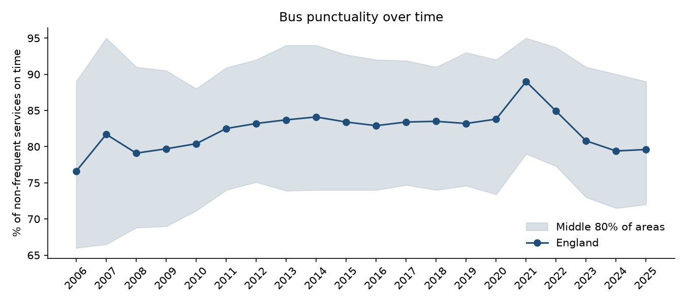
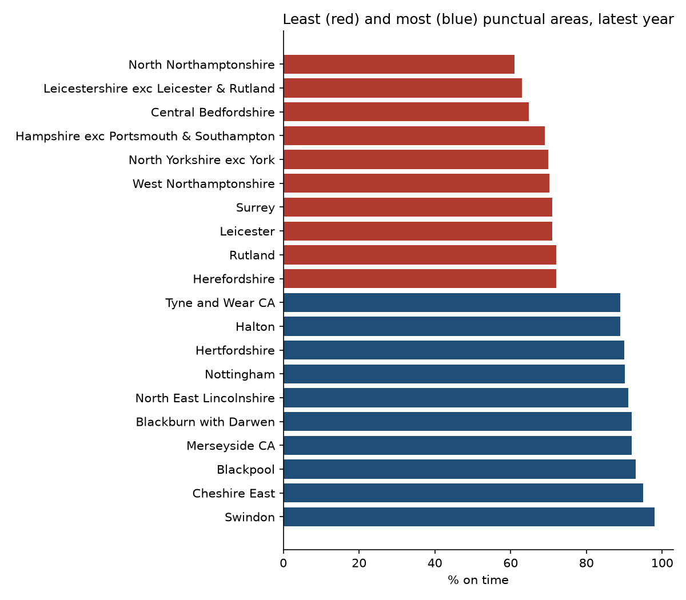
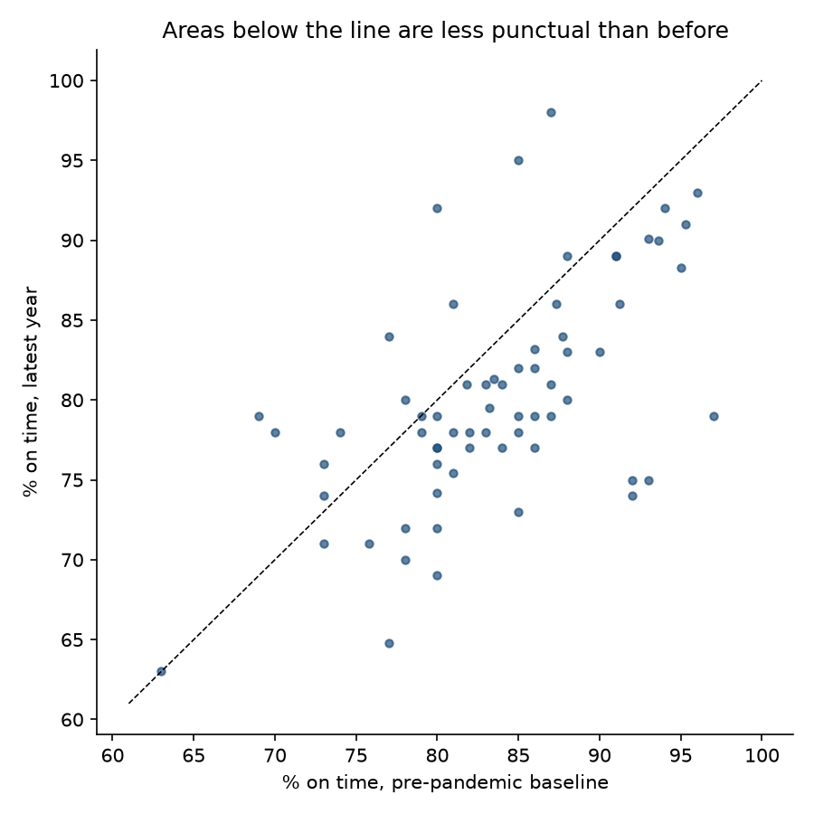

# Results

Source: DfT table BUS09, 86 local authority areas, 2006 to 2025. Measure: % of non-frequent bus services (fewer than six an hour) running on time.

Years are DfT reporting years ending in March: 2019 means April 2018 to March 2019, the last full year before COVID-19. The 2021 peak reflects lockdown, when roads were empty and timetables were cut.

## Headline

- England: **79.6%** of non-frequent services ran on time in 2025, compared with 76.6% in 2006 and 83.2% in 2019 before the pandemic.
- Best year: 2021 (89.0%). Worst year: 2006 (76.6%).
- In 2025 the most punctual 10% of areas ran at least 89.0% on time, the least punctual 10% at most 72.0%: a gap of 17.0 points (vs 23.0 in 2006).
- 79% of areas with data for both years are less punctual in 2025 than in 2019.

## Least punctual areas, 2025

| Area | % on time |
|---|---|
| North Northamptonshire | 61.0 |
| Leicestershire exc Leicester & Rutland | 63.0 |
| Central Bedfordshire | 64.8 |
| Hampshire exc Portsmouth & Southampton | 69.0 |
| North Yorkshire exc York | 70.0 |
| West Northamptonshire | 70.2 |
| Surrey | 71.0 |
| Leicester | 71.0 |
| Rutland | 72.0 |
| Herefordshire | 72.0 |

## Most punctual areas, 2025

| Area | % on time |
|---|---|
| Swindon | 98.0 |
| Cheshire East | 95.0 |
| Blackpool | 93.0 |
| Merseyside CA | 92.0 |
| Blackburn with Darwen | 92.0 |
| North East Lincolnshire | 91.0 |
| Nottingham | 90.1 |
| Hertfordshire | 90.0 |
| Halton | 89.0 |
| Tyne and Wear CA | 89.0 |

## Biggest falls since 2019

| Area | 2019 | 2025 | Change (pts) |
|---|---|---|---|
| Buckinghamshire exc Milton Keynes | 92.0 | 74.0 | -18.0 |
| Derby | 93.0 | 75.0 | -18.0 |
| Warwickshire | 97.0 | 79.0 | -18.0 |
| Essex exc Southend & Thurrock | 92.0 | 75.0 | -17.0 |
| Central Bedfordshire | 77.0 | 64.8 | -12.2 |
| Greater Manchester CA | 85.0 | 73.0 | -12.0 |
| Hampshire exc Portsmouth & Southampton | 80.0 | 69.0 | -11.0 |
| Cornwall exc. Scilly Isles | 86.0 | 77.0 | -9.0 |
| North Yorkshire exc York | 78.0 | 70.0 | -8.0 |
| Rutland | 80.0 | 72.0 | -8.0 |

## Biggest improvements since 2019

| Area | 2019 | 2025 | Change (pts) |
|---|---|---|---|
| Merseyside CA | 80.0 | 92.0 | +12.0 |
| Swindon | 87.0 | 98.0 | +11.0 |
| Dorset exc Poole & Bournemouth | 69.0 | 79.0 | +10.0 |
| Cheshire East | 85.0 | 95.0 | +10.0 |
| Southend | 70.0 | 78.0 | +8.0 |
| Stoke-on-Trent | 77.0 | 84.0 | +7.0 |
| Lancashire exc Blackburn & Blackpool | 81.0 | 86.0 | +5.0 |
| Lincolnshire | 74.0 | 78.0 | +4.0 |
| Wokingham | 73.0 | 76.0 | +3.0 |
| Norfolk | 78.0 | 80.0 | +2.0 |

